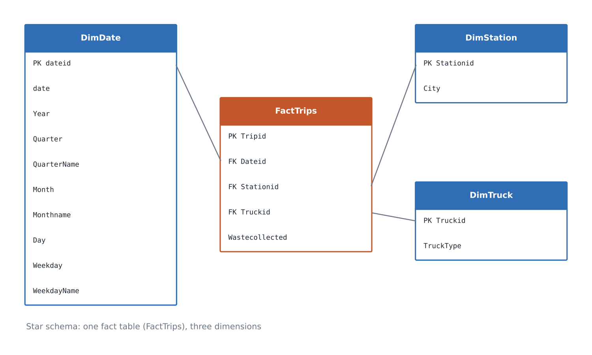
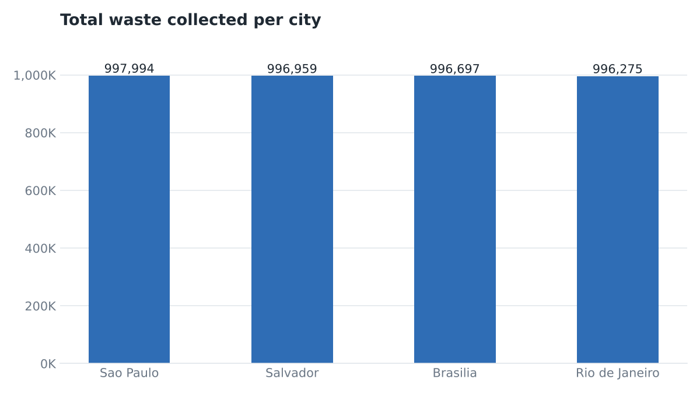
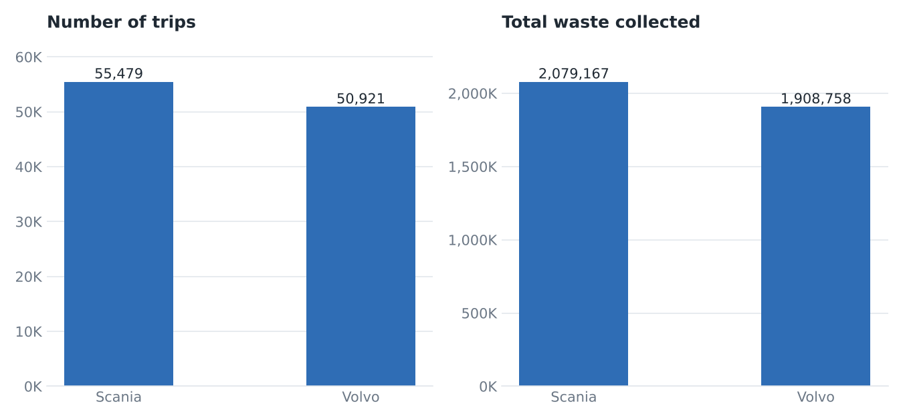
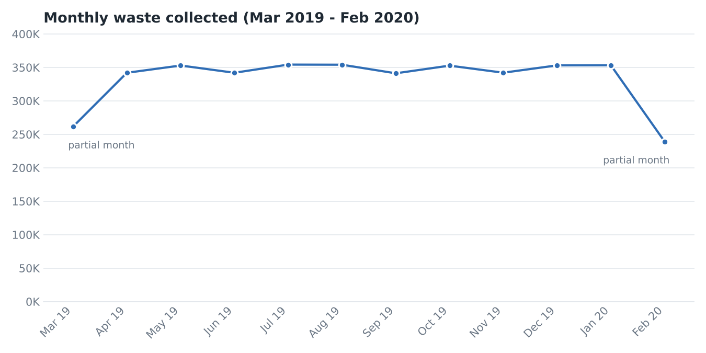

# Transformation Steps

This document describes the pipeline implemented in the `sql/` scripts, in run order.

## 1. Schema Design (`01_create_tables.sql`)

A star schema was created in SQL Server:

- 3 dimension tables: `DimDate`, `DimStation`, `DimTruck`
- 1 fact table: `FactTrips`, linked to each dimension through foreign keys

Data-type decisions made while loading the raw CSV files:

| Column                    | In the CSV | In SQL Server   | Why                                      |
|---------------------------|------------|-----------------|------------------------------------------|
| `DimDate.date`            | string     | `DATE`          | Proper date type for filtering/grouping  |
| `FactTrips.Wastecollected`| float      | `DECIMAL(10,2)` | Exact numeric values, no float rounding  |
| Text columns              | string     | `VARCHAR(n)`    | Bounded length                           |

All columns are `NOT NULL`, and every table has a primary key.

## 2. Data Loading (`02_load_data.sql`)

- Loaded with `BULK INSERT` using `FORMAT = 'CSV'`, `FIRSTROW = 2` (skips the header) and `FIELDQUOTE = '"'`.
- Dimensions are loaded first and the fact table last, so the foreign keys are satisfied.

## 3. Data Quality Checks (`03_data_quality_checks.sql`)

| Check                          | How                                                         | Result                    |
|--------------------------------|-------------------------------------------------------------|---------------------------|
| Row counts                     | `COUNT(*)` per table vs the CSV row counts                  | 350 / 19 / 71 / 106,400   |
| NULL values                    | `COUNT(column)` vs `COUNT(*)` on `FactTrips`                | 0 NULLs                   |
| Duplicate keys                 | `GROUP BY ... HAVING COUNT(*) > 1` on `Tripid` and `dateid` | 0 duplicates              |
| Orphan foreign keys            | `LEFT JOIN` + `IS NULL` for date, station and truck         | 0 orphans                 |
| Join sanity check              | `TOP 20` rows of the fact joined to all dimensions          | Joins work as expected    |
| Measure statistics             | `MIN`, `MAX`, `AVG`, `SUM` of `Wastecollected`              | See below                 |

The data was already clean, so no rows were deleted or modified.

| Statistic            | Value        |
|----------------------|--------------|
| Min waste per trip   | 30.00        |
| Max waste per trip   | 45.00        |
| Avg waste per trip   | 37.48        |
| Total waste          | 3,987,925.34 |

## 4. Analysis (`04_analysis_queries.sql`)

- Total waste per city.
- Number of trips, total and average waste per truck type.
- Monthly waste trend (year / month).

## 5. Aggregated Table (`05_monthly_city_waste.sql`)

Created `MonthlyCityWaste`, a summary table holding total waste per city per month, built by joining `FactTrips` with `DimDate` and `DimStation`. The script truncates the table before inserting, so it can be re-run safely.

## 6. Results

### Waste per city

| City           | Total waste |
|----------------|-------------|
| Sao Paulo      | 997,994.16  |
| Salvador       | 996,958.80  |
| Brasilia       | 996,697.25  |
| Rio de Janeiro | 996,275.13  |

The four cities are almost identical: the gap between the highest and the lowest is only about 0.17%.

### Waste per truck type

| Truck type | Trips  | Total waste  | Avg waste per trip |
|------------|--------|--------------|--------------------|
| Scania     | 55,479 | 2,079,167.04 | 37.48              |
| Volvo      | 50,921 | 1,908,758.30 | 37.48              |

Scania trucks made about 9% more trips and so collected more in total, but the average waste per trip is identical for both types.

### Monthly trend

- The data covers 9 March 2019 to 21 February 2020, so **March 2019 and February 2020 are partial months** and look lower only because they have fewer days.
- Full months range between roughly 341K and 354K, which is about 11.4K per day. The small differences between months follow the number of days in each month.

### Waste per weekday

Every weekday collects about 570K (between 569.0K and 570.2K), so there is no weekday effect.

### Takeaway

Waste volumes are very evenly spread across cities, truck types, weekdays and months. No city, truck type or period stands out, which suggests this is a synthetic or highly balanced dataset. The project's value is in the pipeline (modeling, loading, validation, aggregation) rather than in business findings.
